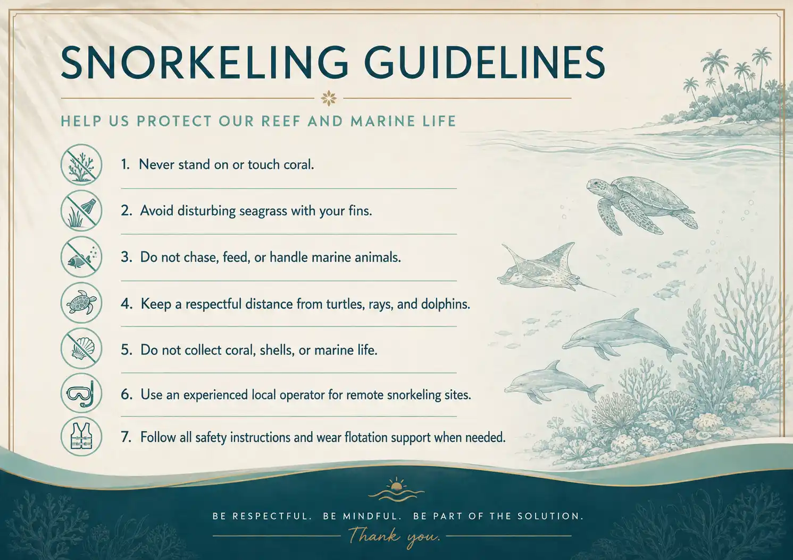

Cambodia is often celebrated for its ancient temples, vibrant culture, and idyllic islands. But beneath the calm waters of the Gulf of Thailand lies another treasure waiting to be explored. While the country may not boast the vast coral reefs of Indonesia or the Maldives, **snorkeling in Cambodia** offers something equally rewarding: coral gardens, seagrass meadows teeming with life, and a chance to experience marine biodiversity without the crowds found elsewhere in Southeast Asia.

Whether you are staying at a **beach resort in Cambodia**, exploring the islands around Sihanoukville, or simply looking for a new adventure during your holiday, snorkeling is one of the easiest and most memorable ways to connect with nature.

## Why Snorkeling in Cambodia Is Worth Discovering

Cambodia’s coastline stretches for more than 400 kilometres and is dotted with dozens of tropical islands. Unlike destinations where coral reefs dominate the landscape, Cambodia’s underwater world is a fascinating mix of coral reefs, seagrass meadows, mangroves, rocky coastlines, and sandy seabeds.

This diversity creates habitats for an impressive variety of marine life. One moment you may be floating above colourful reef fish, while the next you are gliding over seagrass beds that serve as nurseries for many marine species. Every snorkeling trip feels a little different.

## Where to Snorkel in Cambodia

### Koh Rong

Cambodia’s most famous island is also one of its most popular snorkeling destinations. Around the quieter beaches and rocky headlands, visitors can discover shallow reefs populated by butterflyfish, damselfish, wrasses, rabbitfish, groupers, and snappers.

Many **Koh Rong resorts** organise half-day snorkeling excursions to nearby reefs that are difficult to reach from the shore. Conditions vary around the island, so joining a local guide is often the best way to find the clearest and calmest locations.

### Koh Rong Samloem

Often considered Koh Rong’s quieter sister island, Koh Rong Samloem offers sheltered bays and attractive snorkeling conditions during the dry season. Visibility is commonly around 10 metres and can reach 20 metres or more on particularly clear days.

The island’s shallow reefs, rocky edges, coral formations, and sandy areas make it suitable for both beginners and more experienced snorkelers.

### Koh Russey (Bamboo Island)

For travelers seeking a quieter and more exclusive snorkeling experience, **Koh Russey** offers a peaceful alternative to Cambodia’s larger islands. Surrounded by the calm waters of the Gulf of Thailand, the island provides excellent conditions for swimming, kayaking, paddleboarding, and snorkeling close to shore. While the coral reefs are more modest than those found around the remote islands such as Koh Tang, guests can still discover colourful tropical fish and enjoy the tranquility of an uncrowded marine environment. Staying at **Koh Russey Resort** allows visitors to combine luxury, nature, and easy access to some of Cambodia’s beautiful coastal waters, making it an ideal choice for couples, families, and anyone looking to unwind on a private island.

### Koh Tang

For experienced snorkelers or travellers joining a dedicated boat excursion, Koh Tang is widely regarded as one of Cambodia’s best underwater destinations.

Located around 50 kilometres offshore, its remote position often provides clearer water and more extensive reef scenery than many inshore locations. Visibility commonly ranges from around 10 to 30 metres, depending on weather and sea conditions.

Because Koh Tang is remote and exposed to open-water conditions, it should only be visited with an experienced operator providing proper boat support and safety equipment.

## What Marine Life Can You See?

One of the joys of snorkeling in Cambodia is never quite knowing what you may encounter. Common sightings can include:

- Butterflyfish
- Damselfish
- Rabbitfish
- Wrasses
- Groupers
- Snappers
- Goatfish
- Sea stars
- Sea urchins
- Sea cucumbers
- Octopus
- Cuttlefish
- Nudibranchs
- Moray eels
- Stingrays
- Seahorses and pipefish in suitable habitats

If you are particularly fortunate, you may also see a sea turtle or a dolphin from the boat. Cambodia’s waters are home to several protected marine species, but these encounters are never guaranteed and should always be enjoyed from a respectful distance.

## When Is the Best Time to Go Snorkeling?

The most reliable period for **snorkeling in Cambodia** generally runs from November to April, when the sea is often calmer and underwater visibility is more dependable.

Morning excursions are usually the best choice. Winds, boat traffic, and disturbed sediment can reduce visibility later in the day, particularly around shallow reefs and sandy areas.

Snorkeling can still be possible during Cambodia’s Green Season, but conditions become more dependent on recent rainfall, wind, waves, and the location of the reef. A calm morning after several dry days may still offer an enjoyable experience.

## Snorkeling During a Stay at Koh Russey Resort

A stay at Koh Russey Resort offers guests an opportunity to enjoy Cambodia’s island environment from a peaceful and refined setting. Surrounded by tropical vegetation and the waters of the Gulf of Thailand, the resort is an ideal base for guests who want to combine relaxation with outdoor discovery.

Snorkeling can be part of a wider island experience that includes kayaking, paddleboarding, swimming, beach walks, and time spent enjoying the natural surroundings. Conditions and available activities may vary depending on the weather, tides, and sea conditions.

For travellers looking for a **resort in Cambodia** that combines beachside comfort with access to nature, Koh Russey offers a memorable alternative to the busier islands.

## How to Snorkel Responsibly

*Snorkeling Guide*

Cambodia’s marine ecosystems are sensitive, and responsible behaviour helps protect them. When snorkeling:

- Never stand on or touch coral.
- Avoid disturbing seagrass with your fins.
- Do not chase, feed, or handle marine animals.
- Keep a respectful distance from turtles, rays, and dolphins.
- Do not collect coral, shells, or marine life.
- Use an experienced local operator for remote snorkeling sites.
- Follow all safety instructions and wear flotation support when needed.

Small actions from every visitor can help preserve Cambodia’s underwater habitats for future generations.

## Discover Cambodia Below the Surface

Whether you are spending a weekend on Koh Rong, enjoying the tranquility of Koh Rong Samloem, or relaxing at a luxury **beach resort in Cambodia** such as Koh Russey Resort, snorkeling adds a new dimension to an island holiday.

Floating above coral, watching tropical fish move between rocks, and exploring peaceful seagrass habitats reveals a side of Cambodia that many visitors never see.

Sometimes, the country’s most memorable discoveries are waiting just beneath the surface.

[Discover Koh Russey Resort](/)
